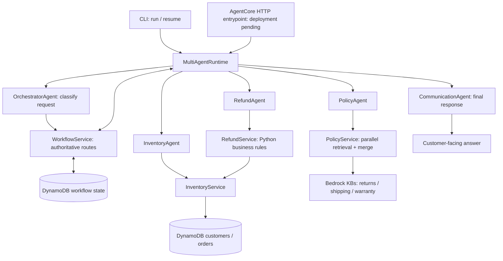

# NovaMart Multi-Agent Customer Support

**Retail support with specialist agents, grounded policy retrieval, and explicit business rules.**

[](pyproject.toml)
[](#implementation-status)
[](docs/evidence/pytest-communication.xml)

NovaMart is a Python customer-support system for an example retailer. Five Strands agents
coordinate customer and order lookups, policy questions, refund eligibility, and final
responses. Amazon Bedrock supplies model inference and policy retrieval; DynamoDB stores
customer records, orders, and versioned workflow state.

The goal is a reproducible, observable support service hosted on **Amazon Bedrock AgentCore**.
The current repository implements the application core, an AWS-backed CLI, an AgentCore
HTTP entrypoint, and CDK data, policy, image-registry, and runtime stacks. The ARM64 container
has passed local build and smoke checks. The data, image-registry, and policy stacks are deployed;
live policy ingestion and retrieval passed. Three AWS-backed application smoke scenarios
also passed after a Decimal-serialization repair. AgentCore creation remains denied;
hosted acceptance is pending.

[Vision](#vision) · [Architecture](#architecture) · [Quick start](#quick-start) ·
[Evidence](#evidence-and-verification) · [Roadmap](#completion-roadmap)

## Vision

A useful support assistant needs to connect an answer to the customer's actual order,
the applicable policy, and a defensible decision. NovaMart separates those responsibilities
so each part can be tested and changed independently.

For example, a customer asks, **“Can I return order ORD-1001?”** The system classifies the
request, retrieves the customer's tier and order facts, evaluates eligibility using Python
business rules, and asks the communication specialist to explain the result. A language
model does not choose the return window or calculate the refund amount.

The intended outcome is a support service that is easier to inspect: reviewers can follow
the route taken, inspect the persisted context, reproduce business decisions, and see
where policy evidence came from. Every specialist has a bounded responsibility; additional
agents should earn their place through a concrete operational need.

## Implementation status

**Version 0.1.0 · Application foundation implemented; production deployment unfinished.**

| Area | Present in this repository | Remaining work |
| --- | --- | --- |
| Agents and execution | Five Strands agent builders, bounded tools, typed outputs, and deterministic routing; three live AWS-backed smoke scenarios passed | Hosted acceptance and broader end-to-end evaluation |
| Persistence | DynamoDB adapters and optimistic locking; live workflow summaries match persisted records and terminal resume results | Hosted-role verification, concurrency failure injection, and operational policies |
| Policy retrieval | Concurrent KB adapters, evidence ranking/deduplication, and source-failure reporting; all three deployed KBs ingested and retrieved demo sources successfully | Owner-approved commercial policies, generated-answer evaluation, and failure-injection checks |
| Refund eligibility | Deterministic tier-based rules and decimal arithmetic | Any payment/refund execution integration; the current service evaluates eligibility only |
| CLI and sample data | New-workflow and resume commands, JSON summaries, non-overwriting demo seeding | Hosted workflow recordings and reviewer walkthrough |
| Hosted entrypoint | SDK HTTP handler, validated payloads, context-owned sessions, fresh agents, sanitized errors; ARM64 image smoke-tested and pushed to ECR | Runtime creation permission dependency and live endpoint acceptance |
| Infrastructure | Data, policy, and ECR stacks deployed; digest-selected AgentCore runtime defined with scoped execution permissions | Runtime acceptance, guardrail, and full observability infrastructure |
| Safety | Tool boundaries, validation, controlled errors, and optional retrieval guardrail configuration | Guardrails across model interactions, adversarial evaluation, authentication, and authorization |
| Observability | Session IDs, route history, versioned state, and configuration fields | Structured logging, tracing, dashboards, and alarms; the observability package is currently empty |
| Delivery | Local test, lint, type-check, and infrastructure evidence | CI workflow, deployment automation, and release evidence |

The local interface is a **command-line application**. An AgentCore HTTP entrypoint is
implemented and tested through the SDK, but has not been deployed. There is no web chat UI,
AgentCore Memory integration, or payment processor in this checkout.
The [architecture document](docs/architecture/ARCHITECTURE.md) describes the broader target;
the table above distinguishes that target from today's implementation.

## Architecture



This diagram shows application relationships. The runtime invokes only the specialists
required by the selected route; it does not invoke all five agents on every request.

### Agent responsibilities

| Agent | Responsibility | Boundary |
| --- | --- | --- |
| **OrchestratorAgent** | Classify the request and initialize or inspect its workflow | Obtains the legal next agent from the workflow service; does not compose the final answer |
| **InventoryAgent** | Retrieve customer profiles, tiers, orders, and order status | Supplies facts; does not decide policies or refunds |
| **PolicyAgent** | Search and interpret source-backed policy evidence | Does not decide customer-specific refund eligibility |
| **RefundAgent** | Use the refund tool to obtain an eligibility decision | Does not invent order facts or execute a payment |
| **CommunicationAgent** | Explain the accumulated facts and decisions | Runs last; must not claim an action occurred without supporting workflow context |

The orchestrator's **classification is model-driven**. Once classified, the specialist
sequence is defined in [WorkflowService](src/novamart_support/services/workflow.py) and
checked by the runtime.

### Routing contract

All new requests start with the orchestrator. The following sequences show the specialists
that run after classification:

| Request type | Example | Specialist sequence |
| --- | --- | --- |
| `return_refund` | “Can I return order ORD-1001?” | Inventory → Refund → Communication |
| `order` | “Has order ORD-1002 shipped?” | Inventory → Communication |
| `account` | “What tier am I?” | Inventory → Communication |
| `policy` | “What does the warranty cover?” | Policy → Communication |
| `calculation` | “What is 149.99 multiplied by two?” | Communication |
| `general` | “Hello, can you help?” | Communication |

Order-status requests do not run the refund specialist. Refund eligibility uses local
business rules; policy retrieval is a separate question-answering path.

### Reliability and decision boundaries

- **Persisted progress:** specialist context, route history, final response, timestamps,
  and version are stored per session. `resume` continues an active workflow at its next
  legal step. A failed terminal workflow is not automatically retried by `resume`.
- **Optimistic concurrency:** conditional writes reject stale workflow versions instead
  of silently overwriting newer state.
- **Typed execution:** Pydantic output contracts reject malformed agent results. Execution
  failures mark an active workflow as failed.
- **Policy fault isolation:** three retrievers run concurrently. Successful evidence is
  ranked and deduplicated, and failed sources are reported. No usable evidence produces
  a controlled retrieval error.
- **Deterministic refunds:** standard customers have a 30-day return window; premium
  customers have 60 days. Eligibility also checks delivery status, delivery date, the
  return flag, and whether the order was already refunded. Amounts use `Decimal`.
- **Bounded claims:** agent prompts require factual tool use and prohibit unsupported
  completion claims. These instructions still need live model and security evaluation.

## Technology

| Layer | Implementation |
| --- | --- |
| Language and packaging | Python 3.12, Hatchling, `uv`, committed dependency lockfile |
| Agents and models | Strands Agents with Amazon Bedrock models; AgentCore SDK HTTP entrypoint |
| Configuration and contracts | Pydantic and pydantic-settings |
| Data | Boto3 DynamoDB adapters and in-memory test repositories |
| Retrieval | Bedrock Knowledge Base `retrieve` adapters |
| Infrastructure | AWS CDK in Python |
| Verification | pytest, Moto AWS mocks, CDK assertions, Ruff, strict mypy |

Default model IDs are defined in [.env.example](.env.example): Claude Haiku 4.5 for
orchestration and Claude Sonnet 4.5 for workers. Model access and availability must be
confirmed in the AWS account and region used for deployment.

## Quick start

### 1. Install the development environment

Prerequisites: Git, **Python 3.12**, and **uv**. CDK synthesis also requires Node.js;
[.node-version](.node-version) records the repository's intended Node version.

```bash
git clone https://github.com/TripleJay23/novamart-multi-agent-support.git
cd novamart-multi-agent-support
uv sync --locked --extra dev
```

### 2. Run local checks without an AWS deployment

```bash
uv run --locked --extra dev pytest -q
uv run --locked --extra dev ruff check .
uv run --locked --extra dev mypy src/novamart_support
uv run --locked --extra dev python -m novamart_support --help
uv run --locked --extra dev python docs/evidence/local_demo.py
```

The test suite uses mocks and test doubles rather than live Bedrock calls. The local demo
uses real domain services with in-memory data and a fixed clock; it does not invoke a
model, persist to AWS, or demonstrate a full agent conversation.

### 3. Configure the AWS-backed CLI

Copy the example configuration:

```bash
# macOS / Linux
cp .env.example .env
```

```powershell
# PowerShell
Copy-Item .env.example .env
```

Use the normal AWS credential provider chain, such as an authenticated AWS profile.
The application has no custom credential loader. Keep credentials out of `.env` and
version control.

| Setting | Behavior |
| --- | --- |
| `AWS_REGION` | Defaults to `us-east-1` |
| `PROJECT_NAME` | Defaults to `novamart-support`; used to derive table names |
| `WORKFLOW_TABLE_NAME`, `CUSTOMER_TABLE_NAME`, `ORDER_TABLE_NAME` | Optional overrides; blank values resolve to `novamart-support-workflow-state`, `novamart-support-customers`, and `novamart-support-orders` with the default project name |
| `ORCHESTRATOR_MODEL_ID`, `WORKER_MODEL_ID` | Bedrock model or inference-profile IDs used by the agent builders |
| `RETURNS_KB_ID`, `SHIPPING_KB_ID`, `WARRANTY_KB_ID` | **All three are required** by application composition, even for a non-policy CLI request |
| `GUARDRAIL_ID`, `GUARDRAIL_VERSION` | Optional pair, currently forwarded to KB retrieval; not applied across all model invocations |
| `AGENTCORE_RUNTIME_ARN` | Reserved setting; the current CLI executes the application locally rather than calling an AgentCore endpoint |
| `AGENT_TRACING_ENABLED`, `AGENT_TRACE_SAMPLING_RATE`, `AGENT_LOG_LEVEL` | Defined settings; an application observability pipeline is not yet wired |

### 4. Prepare cloud resources

Synthesize the **data and policy stacks** locally:

```bash
uv run --locked --extra dev python -m infrastructure.app
```

The data stack defines three on-demand DynamoDB tables with point-in-time recovery and a private,
encrypted, versioned S3 policy-document bucket with TLS enforcement. The order table uses
`customer_id` as its partition key and `order_id` as its sort key.

With the AWS CDK CLI installed and your intended AWS account/profile selected, deployment
uses the repository's `cdk.json` application:

```bash
cdk bootstrap
cdk diff NovaMartDataStack NovaMartPolicyStack
cdk deploy NovaMartDataStack NovaMartPolicyStack
```

These deployment commands create billable AWS resources. The current stack uses
`RemovalPolicy.DESTROY`; review retention settings before putting real customer data in it.
The CDK app currently fixes the project name to `novamart-support`; changing `PROJECT_NAME`
in `.env` alone does not rename the stack's tables.

The policy stack defines three Bedrock Knowledge Bases with separate S3 vector indexes
and domain-scoped ingestion/retrieval roles. The vector bucket and indexes use `RETAIN`.
Upload the [versioned demonstration policies](data/policies/) and start ingestion explicitly
using the [policy-environment runbook](docs/deployment/policy-environment.md), then configure
the resulting KB IDs. Returns mirror the current business rules; shipping and warranty
documents explicitly acknowledge missing commercial terms rather than inventing them.

Provide your local caller with AWS permissions for DynamoDB, inference, and retrieval
before running a live CLI workflow. Local synthesis is not evidence of successful resource
creation or ingestion.

For hosted execution, follow the [AgentCore runtime runbook](docs/deployment/agentcore-runtime.md).
The additional image and runtime stacks define the ECR repository, runtime role, environment
references, and HTTP runtime. Build and inspect a `linux/arm64` image, push it, and supply its
digest before deploying the runtime stack. The local CLI remains a direct AWS-backed client
of the application; use the documented AgentCore invocation to call the hosted endpoint.

### 5. Seed sample customers and orders

After the customer and order tables exist:

```bash
uv run --locked novamart-seed --json
```

Seeding inserts missing records using conditional writes and skips existing ones. It does
not overwrite records, refresh their dates on later runs, or seed policy documents.
Dates are relative to the seed time by default; `--reference-time` accepts a timezone-aware
ISO-8601 value for repeatable scenarios.

| Customer | Order | Scenario at the seed reference time |
| --- | --- | --- |
| `CUST-1001` · premium | `ORD-1001` · headphones | Delivered 10 days ago; eligible for a 149.99 refund |
| `CUST-1001` · premium | `ORD-1002` · watch | Shipped, not delivered; ineligible |
| `CUST-2001` · standard | `ORD-2001` · office chair | Delivered 35 days ago; outside the 30-day window |
| `CUST-2001` · standard | `ORD-2002` · USB-C hubs | Already refunded; ineligible |

### 6. Run or resume a live workflow

These commands require the AWS resources and configuration described above and invoke
Bedrock models:

```bash
uv run --locked novamart-support run --session-id demo-return-001 --customer-id CUST-1001 --query "Can I return order ORD-1001?" --json
uv run --locked novamart-support run --session-id demo-policy-001 --query "What does the warranty cover?" --json
uv run --locked novamart-support resume --session-id demo-return-001 --json
```

Use a new session ID for each new request. Omit `--json` to print the final response.
JSON summaries contain the session/customer identifiers, request type, status, route
history, final response, and version; they omit the internal specialist context objects.

CLI exit codes: `0` for a successful result, `1` for handled application/configuration
errors, and `2` for a returned failed workflow or an argument-parsing error. The CLI is a
developer interface; its identifiers and route history should not be exposed directly in
a future customer-facing UI.

## Evidence and verification

The latest working tree passes **195 tests**, Ruff, and strict mypy after repairing
numeric context serialization and tightening communication grounding. A versioned live
evaluation passed **five focused cases** for supported and missing currency/estimate facts.
See the [grounding evidence](docs/evidence/communication-grounding.md),
[fresh verification](docs/evidence/communication-verification.txt), and
[JUnit report](docs/evidence/pytest-communication.xml). These changes remain uncommitted
on top of `8a95621`. The earlier
[three AWS-backed workflow checks](docs/evidence/live-application.json) preceded the
new communication prompt; their evidence is preserved separately.

The original pre-deployment verification snapshot below was captured on **18 October 2026** against the
working tree based on revision [`f8616b5`](https://github.com/TripleJay23/novamart-multi-agent-support/commit/f8616b520aa3ef4e18beec018c20200a5b916c87),
including the uncommitted policy-infrastructure and AgentCore runtime milestones.
These are local checks, not deployment or model-quality results.

| Check | Observed result | Evidence |
| --- | --- | --- |
| pytest | **183 passed**, 0 failures, 0 errors, 0 skipped; one SDK deprecation warning | [JUnit report](docs/evidence/pytest-results.xml) |
| Test layers | 150 unit, 13 mocked integration, 20 infrastructure tests | [Evidence index](docs/evidence/README.md) |
| Ruff | All checks passed | [Captured verification transcript](docs/evidence/verification.txt) |
| Strict mypy | No issues in 45 source files | [Captured verification transcript](docs/evidence/verification.txt) |
| CLI entrypoints | Support and seed help commands succeeded | [Captured verification transcript](docs/evidence/verification.txt) |
| Local domain demo | Four refund scenarios and all six route definitions | [Reproducible demo](docs/evidence/local_demo.py) · [Captured output](docs/evidence/local-demo.txt) |
| CDK synthesis | All four stacks synthesized; SDK warned that the installed Node 26 version is untested | [Captured verification transcript](docs/evidence/verification.txt) |
| Hosted HTTP contract | SDK health/invocation endpoints and session isolation passed with fake application dependencies | [Entrypoint tests](tests/unit/test_agentcore_entrypoint.py) |
| ARM64 image | Locked dependencies installed; image inspected as `linux/arm64`; runtime reports `aarch64` and Python 3.12.15 | [Build transcript](docs/evidence/container-build.txt) · [Build metadata](docs/evidence/container-build-metadata.json) |
| Container smoke checks | **7 passed**: non-root/no credentials/no mounts, source correspondence, health, and four controlled-error cases; temporary container removed | [Container report](docs/evidence/container-smoke.json) · [Runtime logs](docs/evidence/container-runtime.txt) |

The local image `novamart-support:local-arm64` ran through Docker Desktop's ARM64 emulation
on an amd64 engine. Its installed application source hash matches the working tree.
These local checks made no AWS calls. A subsequent clean-revision image was pushed to ECR.
All three policy sources were ingested and retrieved successfully in AWS. The repaired
working tree completed policy, refund, and order scenarios with matching persisted state
and unchanged terminal resumes. Its corrected ARM64 image passed seven checks and was
pushed as `8a95621-decimal-fix`. Hosted runtime acceptance remains pending after three
creation denials. See the
[cloud deployment evidence](docs/evidence/cloud-deployment.md) for observed results and
unresolved image-scan findings.

### Local demonstration

```text
CUST-1001 / ORD-1001 | eligible=True  | amount=149.99
CUST-1001 / ORD-1002 | eligible=False | amount=n/a
CUST-2001 / ORD-2001 | eligible=False | amount=n/a
CUST-2001 / ORD-2002 | eligible=False | amount=n/a
```

The excerpt summarizes the domain demo. Its full output includes decision reasons and
the routes selected from the actual workflow service. It demonstrates eligibility
evaluation, not payment execution or generated customer responses.

### Cloud and screenshot evidence

No NovaMart cloud-console or live-conversation screenshots are committed yet. The
[evidence index](docs/evidence/README.md#cloud-evidence-to-capture) defines the captures
needed to complete the portfolio: deployed runtime, persisted workflow, grounded policy
answers, refund decisions, guardrail behavior, and traces. Each capture should link to
its command or test case and state what it proves.

The presentation follows the architecture, capability, and evidence structure of the
related [Bedrock AgentCore Customer Support Chatbot](https://github.com/TripleJay23/bedrock-AgentCore-customer-support-chatbot).
That project's screenshots and evaluation scores describe a different implementation
and are not evidence for NovaMart.

## Repository structure

```text
novamart-multi-agent-support/
├── src/novamart_support/
│   ├── agents/          # Five agent builders, prompts, and Strands tool bindings
│   ├── domain/          # Customer, order, policy, refund, and workflow models
│   ├── repositories/    # Customer/order adapters: DynamoDB and in-memory
│   ├── state/           # Workflow repositories and concurrency control
│   ├── services/        # Inventory, policy retrieval, refund rules, routing
│   ├── tools/           # Framework-neutral tool handlers and result contracts
│   ├── rag/             # Bedrock Knowledge Base retrieval adapters
│   ├── runtime/         # Dependency composition and typed execution loop
│   ├── observability/   # Placeholder for logging and tracing implementation
│   ├── config.py        # Typed environment settings
│   ├── agentcore.py     # Hosted run/resume contract and SDK HTTP server
│   ├── cli.py           # Workflow run/resume interface
│   └── seed.py          # Non-overwriting sample customer/order data
├── infrastructure/      # CDK data, policy/KB, image registry, and runtime stacks
├── Dockerfile           # Locked production dependencies and non-root runtime
├── examples/agentcore/  # Synthetic run/resume JSON payloads
├── tool/                # Reproducible local container smoke verification
├── data/policies/       # Versioned returns, shipping, and warranty demo documents
├── tests/
│   ├── unit/            # Services, state, tools, agents, runtime, configuration, CLI
│   ├── integration/     # DynamoDB adapters and seed scenarios with Moto
│   └── infrastructure/  # Synthesized CDK template assertions
├── docs/
│   ├── architecture/    # Target architecture and engineering contracts
│   ├── deployment/      # Policy ingestion and container/runtime deployment guides
│   └── evidence/        # Verification report, transcript, and local demo
├── .env.example
├── .node-version
├── cdk.json
├── pyproject.toml
└── uv.lock
```

## Completion roadmap

1. **Verify the AWS data and policy environment.** The data/policy stack definitions,
   demo documents, and ingestion runbook are implemented. Foundation deployment, all three
   policy ingestions, direct source retrieval, and non-overwriting seeding are verified in
   [AWS evidence](docs/evidence/cloud-deployment.md). Generated-answer evaluation and
   hosted-role access remain separate checks. Three locally executed AWS-backed workflows
   have also passed smoke checks.
2. **Verify hosted execution on AgentCore.** The runtime entrypoint, deployment stacks,
   scoped execution role, session mapping, and invocation examples are implemented.
   The ARM64 image has passed local build and smoke checks and was pushed to ECR.
   The latest working-tree image is available as `8a95621-communication-v1`. Runtime
   creation remains denied after three attempts; the account administrator must inspect
   the blocked CloudTrail event before another permission change. Capture a hosted
   workflow after deployment succeeds.
   Resolve the recorded high-severity OS-package scan findings before release.
   Decide whether AgentCore Memory is needed alongside workflow persistence.
3. **Complete safety and access controls.** Apply guardrails consistently to model
   interactions, establish authenticated customer identity and order authorization,
   and evaluate prompt injection, missing facts, and unauthorized lookups.
4. **Make failures observable.** Implement structured logs and traces with session
   correlation, redaction, latency/error metrics, and alarms; prove retriever failure
   and workflow concurrency behavior in the deployed environment.
5. **Automate acceptance.** A [versioned communication regression](evals/README.md) now
   covers five focused cases using real Bedrock and in-memory context. Expand it into
   end-to-end order, account, refund, policy, calculation, missing-data, and partial-failure
   evaluations, then add CI and hosted smoke checks with explicit acceptance criteria.
6. **Publish the finished evidence package.** Capture reproducible live CLI sessions,
   sanitized console screenshots, state records, guardrail assessments, traces, and raw
   evaluation results. Add a release walkthrough and deployment/cleanup instructions.

A release is complete when another developer can reproduce the deployment and connect
each advertised capability to a passing test or a recorded cloud run. A web interface or
payment execution would be a separate product extension.

## Contributing

Keep agent prompts, deterministic business rules, AWS adapters, and infrastructure in
their respective layers. Run the local checks before proposing a change, and update the
evidence when a claim or behavior changes. Use synthetic data in public artifacts and
remove customer information, credentials, and account-specific identifiers from captures.

## References

- [uv: locking and syncing](https://docs.astral.sh/uv/concepts/projects/sync/) —
  lockfile checks, editable installation, and optional dependency selection.
- [AWS CDK CLI reference](https://docs.aws.amazon.com/cdk/v2/guide/cli.html) —
  bootstrap, diff, and deployment commands.

## License

No license file is currently included. Reuse and distribution terms have not yet been
declared by the repository owner.
