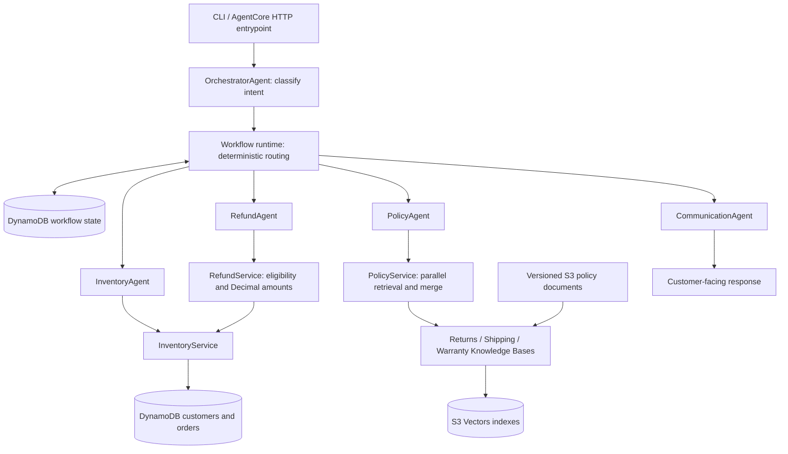

# NovaMart Multi-Agent Customer Support

**Retail support grounded in customer facts, policy evidence, and explicit business rules.**

[](pyproject.toml)
[](infrastructure/)
[](docs/evidence/pytest-communication.xml)

NovaMart is a multi-agent retail support service built with **Strands Agents**, **Amazon
Bedrock**, and **DynamoDB**. Five specialist agents coordinate order and account lookups,
policy questions, refund eligibility, and customer-facing responses. Each request follows
an explicit workflow with persisted context and a traceable sequence of decisions.

The service provides an AWS-backed command-line interface and an **AgentCore HTTP
entrypoint**, with ARM64 container packaging and infrastructure defined in AWS CDK.
Language models interpret requests and explain results; Python services govern routing,
refund rules, and workflow transitions.

[Vision](#vision) · [Capabilities](#capabilities) · [Architecture](#architecture) ·
[Quick start](#quick-start) · [Deployment](#deployment) · [Evidence](#evidence-and-evaluation)

## Vision

Customer support earns trust when an answer connects to the right customer, the actual
order, and the applicable policy. NovaMart makes those connections explicit: factual
lookups, policy interpretation, business decisions, and communication each have a distinct
owner.

The product's purpose is to make support **consistent, explainable, and reproducible**.
A retailer can inspect the route behind an answer, review its supporting evidence, and
change a business rule without rewriting agent prompts. Specialist agents operate through
bounded tools, while shared contracts keep reasoning separate from persistence and
infrastructure.

The target operating model extends these foundations with authenticated customer identity,
order-ownership authorization, consistent guardrail coverage, correlated telemetry, and
release evaluation gates. AgentCore Memory is an optional conversational-context extension
in that design; DynamoDB remains responsible for durable business workflow state. The
[target architecture](docs/architecture/ARCHITECTURE.md) describes this broader design.

## Capabilities

- **Intent-based coordination.** Classifies order, return/refund, policy, account,
  calculation, and general requests, then executes the appropriate specialist sequence.
- **Customer and order context.** Retrieves customer tiers, profiles, order details, and
  delivery status through read-only inventory tools.
- **Grounded policy retrieval.** Searches returns, shipping, and warranty Knowledge Bases
  concurrently, ranks and deduplicates evidence, and retains source metadata.
- **Deterministic refund eligibility.** Applies tier-based return windows and delivery
  checks, with exact decimal arithmetic for eligible amounts. Refund operations assess
  eligibility; they do not execute payments.
- **Persistent workflows.** Stores specialist context, route history, responses, and
  versions in DynamoDB. Conditional writes protect against stale updates.
- **Session-based execution.** Starts or resumes workflows through the CLI or HTTP
  adapter, with typed outputs and controlled application errors.
- **Reproducible delivery.** Uses a committed dependency lockfile, non-root ARM64 images,
  digest-selected deployment, CDK stack definitions, and versioned evaluation fixtures.

## Architecture



Strands agents use Amazon Bedrock for inference. The runtime validates their structured
outputs and enforces the route defined by
[WorkflowService](src/novamart_support/services/workflow.py). Only the specialists needed
for a request execute; CommunicationAgent produces the final response.

### Agent responsibilities

| Agent | Responsibility |
| --- | --- |
| **OrchestratorAgent** | Classifies intent, initializes the workflow, and identifies the legal next step |
| **InventoryAgent** | Collects factual customer, tier, order, and delivery context |
| **PolicyAgent** | Retrieves and interprets source-backed policy evidence |
| **RefundAgent** | Calls the deterministic refund service and records its eligibility result |
| **CommunicationAgent** | Explains the accumulated facts and decisions in a customer-facing response |

### Request routing

Every new workflow starts with classification. Its specialist route is then fixed:

| Request | Example | Specialist sequence |
| --- | --- | --- |
| Return / refund | "Can I return order ORD-1001?" | Inventory → Refund → Communication |
| Order status | "Has order ORD-1002 shipped?" | Inventory → Communication |
| Account | "What customer tier am I?" | Inventory → Communication |
| Policy | "What is the premium return window?" | Policy → Communication |
| Calculation | "What is 149.99 multiplied by two?" | Communication |
| General | "How can you help me?" | Communication |

### Decision and state contracts

**Refund rules.** Standard customers have a **30-day** return window and premium
customers have **60 days**, measured in whole elapsed days from delivery. Eligibility
also requires a delivered order, a valid delivery date, an enabled return flag, and an
order that has not already been refunded. Eligible amounts use `Decimal` arithmetic.
The implementation is isolated in [RefundService](src/novamart_support/services/refund.py).

**Policy evidence.** Three domain retrievers run independently. Successful results are
merged even when another source fails, with partial retrieval reported in the context.
No usable evidence produces a controlled retrieval failure. The included
[policy documents](data/policies/) are versioned demonstration content; shipping and
warranty sources explicitly identify unspecified commercial terms.

**Workflow lifecycle.** A session represents one support workflow. `resume` continues an
active workflow at its next legal step; a completed or failed terminal workflow retains
its state. Conditional DynamoDB writes enforce expected versions. The persistence layer
is independent of agents and supports in-memory adapters for offline verification.

**Response grounding.** Communication instructions require factual context-tool use,
preserve deterministic decisions, and distinguish known facts from missing information.
An amount alone does not establish currency, and a shipped status does not establish an
arrival date. These behaviors have focused, versioned evaluation cases.

## Quick start

### Install

Use **Python 3.12** and **uv**. Infrastructure tooling also uses Node.js; the repository's
[.node-version](.node-version) records the intended version.

```bash
git clone https://github.com/TripleJay23/novamart-multi-agent-support.git
cd novamart-multi-agent-support
uv sync --locked --extra dev
```

### Explore without AWS

```bash
uv run --locked --extra dev pytest -q
uv run --locked python docs/evidence/local_demo.py
uv run --locked novamart-support --help
```

The test suite uses model doubles, SDK stubs, Moto, and CDK assertions. The domain demo
runs real routing and refund services with in-memory records and a fixed reference clock.
These commands do not perform live inference.

### Configure AWS access

Copy [.env.example](.env.example) to `.env`:

```bash
cp .env.example .env
```

In PowerShell, use `Copy-Item .env.example .env`. Authenticate through the standard AWS
credential provider chain, such as an existing AWS profile. Keep credentials out of
configuration files and version control.

| Configuration | Purpose |
| --- | --- |
| `AWS_REGION` | AWS region; defaults to `us-east-1` |
| `PROJECT_NAME` | Resource-name prefix; defaults to `novamart-support` |
| `CUSTOMER_TABLE_NAME`, `ORDER_TABLE_NAME`, `WORKFLOW_TABLE_NAME` | Optional table-name overrides; blank values use the project prefix |
| `ORCHESTRATOR_MODEL_ID` | Classification model; default is the Claude Haiku 4.5 US inference profile |
| `WORKER_MODEL_ID` | Specialist model; default is the Claude Sonnet 4.5 US inference profile |
| `RETURNS_KB_ID`, `SHIPPING_KB_ID`, `WARRANTY_KB_ID` | Deployed policy Knowledge Base IDs; all three are required by application composition |

The [settings module](src/novamart_support/config.py) defines the full configuration
contract. Select models available to your AWS identity and region. The deployment guides
cover IAM, policy ingestion, and resource configuration.

### Seed and run

With the data resources deployed and policies ingested:

```bash
uv run --locked novamart-seed --json
uv run --locked novamart-support run --session-id return-demo-001 --customer-id CUST-1001 --query "Can I return order ORD-1001?" --json
uv run --locked novamart-support run --session-id policy-demo-001 --query "What is the premium return window?" --json
uv run --locked novamart-support resume --session-id return-demo-001 --json
```

Use a new session ID for each independent question. Omit `--json` to print the final
response. JSON summaries include request type, status, route history, final response,
and workflow version.

Seeding inserts missing synthetic records and preserves existing records. Dates are
relative to the seed reference time; repeated seeding does not refresh them.

| Demonstration order | Scenario at seed time |
| --- | --- |
| `CUST-1001` / `ORD-1001` | Premium customer; delivered 10 days earlier; eligible amount 149.99 |
| `CUST-1001` / `ORD-1002` | Shipped, not delivered; ineligible |
| `CUST-2001` / `ORD-2001` | Standard customer; delivered 35 days earlier; outside the return window |
| `CUST-2001` / `ORD-2002` | Already refunded; ineligible |

## Deployment

The AWS deployment separates data, policy retrieval, image publishing, and application
hosting into four stacks:

| Stack | Resources |
| --- | --- |
| `NovaMartDataStack` | Three on-demand DynamoDB tables and a private, encrypted, versioned S3 document bucket |
| `NovaMartPolicyStack` | Three Bedrock Knowledge Bases, isolated S3 Vectors indexes, data sources, and retrieval roles |
| `NovaMartImageStack` | Retained ECR repository with immutable tags and image scanning |
| `NovaMartRuntimeStack` | AgentCore HTTP runtime, application execution role, and resource references |

Synthesize the infrastructure locally:

```bash
uv run --locked --extra dev python -m infrastructure.app
```

Follow the [policy environment guide](docs/deployment/policy-environment.md) to deploy the
data and policy stacks, upload source documents, and complete ingestion. Then follow the
[AgentCore runtime guide](docs/deployment/agentcore-runtime.md) to publish an ARM64 image
and deploy the runtime by its ECR-confirmed digest. The guides cover permissions,
retention, invocation, rollback, and cleanup.

The HTTP adapter serves `/ping` and `/invocations` on port 8080. A new request is:

```json
{"action": "run", "query": "What is the premium return window?"}
```

A continuation uses `{"action": "resume"}` with the same runtime session. The session ID
comes from the AgentCore request context, is 33–256 non-whitespace characters, and cannot
be overridden by a payload field. Each invocation creates fresh agent instances;
workflow progress belongs to DynamoDB rather than process-global conversation history.

The hosted interface is designed for trusted, IAM-authenticated service callers.
Customer-facing integrations require authenticated identity and customer/order ownership
checks. Review resource retention and use owner-approved policies for a real retailer.

> Deployment assurance: recorded AWS-backed application checks are distinct from
> AgentCore hosted acceptance. Hosted acceptance remains unverified; environment access
> and image-scan findings are documented in the [deployment evidence](docs/evidence/cloud-deployment.md).

## Evidence and evaluation

Verification records use synthetic data and distinguish local tests, live AWS workflows,
model evaluations, and container checks. The recorded verification date is
**18 October 2026**.

| Verification | Recorded result | Supporting record |
| --- | --- | --- |
| Automated tests | **195 passed**: 161 unit, 14 mocked integration, 20 infrastructure | [JUnit](docs/evidence/pytest-communication.xml) |
| Static checks | Ruff passed; strict mypy passed for 45 application source files | [Verification transcript](docs/evidence/communication-verification.txt) |
| AWS-backed workflows | Policy, refund, and order flows completed with matching persisted summaries and unchanged terminal resumes | [Requests and responses](docs/evidence/live-application.json) |
| Policy environment | Three sources ingested; each domain retrieved evidence from its expected prefix | [Cloud verification](docs/evidence/cloud-verification.json) |
| Communication regression | **5 focused live cases passed** for currency and delivery-estimate handling | [Evaluation results](docs/evidence/communication-eval.json) |
| ARM64 container | **7 checks passed**, including source correspondence, non-root execution, health, and controlled errors | [Container report](docs/evidence/container-communication-smoke.json) |

The full-workflow record predates the communication-grounding refinement. The five-case
evaluation uses real Bedrock inference with in-memory workflow context and lexical
checks; it does not establish general semantic correctness or security acceptance.
The [evidence index](docs/evidence/README.md) records provenance, scope, and review limits.

### Example: refund decision

The recorded AWS-backed refund workflow follows
**Inventory → Refund → Communication** and persists this decision excerpt:

```json
{
  "eligible": true,
  "order_id": "ORD-1001",
  "refund_amount": "149.99"
}
```

The [underlying record](docs/evidence/live-application.json) includes the synthetic request,
final response, route, state version, and persistence/resume checks. The assessment does
not execute a payment.

### Reproduce the checks

```bash
uv run --locked --extra dev pytest -q
uv run --locked --extra dev ruff check .
uv run --locked --extra dev mypy src/novamart_support
uv run --locked python tool/evaluate_communication.py --validate-only
```

For the live Bedrock evaluation:

```bash
uv run --locked python tool/evaluate_communication.py --live --output cdk.out/communication-eval.json
```

Live evaluation incurs model usage. The [evaluation guide](evals/README.md) explains the
fixtures, checks, positive controls, and interpretation of results.

## Repository structure

```text
src/novamart_support/
├── agents/          # Five specialist builders, prompts, and Strands tool bindings
├── domain/          # Customer, order, policy, refund, and workflow contracts
├── services/        # Inventory, policy retrieval, refund rules, and routing
├── repositories/    # Customer and order persistence adapters
├── state/           # Versioned workflow persistence and optimistic concurrency
├── rag/             # Bedrock Knowledge Base retrieval adapters
├── tools/           # Bounded agent-facing tool handlers
├── runtime/         # Composition, typed execution, and response summaries
├── agentcore.py     # SDK HTTP entrypoint
├── cli.py           # Run/resume interface
└── seed.py          # Non-overwriting synthetic data seeding

infrastructure/      # Data, policy, image, and runtime CDK stacks
data/policies/       # Versioned demonstration policy sources
evals/               # Communication grounding dataset and evaluation guide
tool/                # Container verification and live evaluation runners
tests/               # Unit, mocked integration, and infrastructure checks
docs/architecture/   # Target design and engineering principles
docs/deployment/     # Environment, ingestion, and runtime runbooks
docs/evidence/       # Verification reports and recorded examples
```

## Documentation

- [Target architecture](docs/architecture/ARCHITECTURE.md)
- [Policy environment and ingestion](docs/deployment/policy-environment.md)
- [AgentCore deployment and HTTP contract](docs/deployment/agentcore-runtime.md)
- [Evaluation dataset and runner](evals/README.md)
- [Evidence index](docs/evidence/README.md)

## Contributing

Keep agent prompts, business rules, AWS adapters, and infrastructure in their respective
layers. Add regression coverage for behavioral changes, run the local checks, and update
relevant evidence when a capability or contract changes. Use synthetic records in public
artifacts and keep credentials and customer information out of commits.
